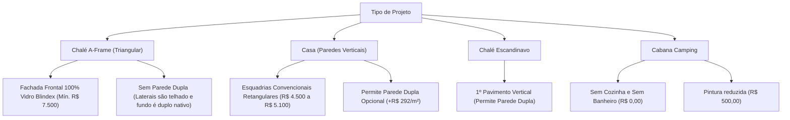

# MANUAL TÉCNICO & DIRETRIZES DE ENGENHARIA DE CUSTOS
## Simulador de Investimento Global 360° — Wood Bahia
**Versão:** 2.0 • **Data de Atualização:** Novembro/2026 • **Status:** Homologado em Produção

---

## 1. OBJETIVO E POSICIONAMENTO COMERCIAL

> **Diferença Crucial de Escopo:**
> * **Contratação Oficial "Wood Bahia Chave na Mão":** Trata-se de um contrato formal fechado de fábrica, com garantia técnica unificada e coordenação direta da montagem estrutural.
> * **Simulação de Investimento Global 360°:** É uma ferramenta de **planejamento financeiro orientativo** com o custo real de entrega da obra pronta. Ela detalha todos os custos de materiais e serviços locais de canteiro (louças, piso cerâmico, bancadas, elétrica, hidráulica, pintura etc.), sendo **indispensável para clientes que compram apenas o Kit Madeiramento ou contratam a Montagem Parceira** calcularem quanto gastarão no total até a chave na porta sem surpresas no orçamento.

---

## 2. TIPOLOGIAS CONSTRUTIVAS E REGRAS DE NEGÓCIO



### Regras por Tipologia:
1. **Chalés A-Frame (Guarajuba, Itacimirim, Baixios, Praia do Forte, Vilas do Atlântico):**
   * As águas do telhado descem até a base e a parede de fundo já é dupla de fábrica.
   * **Bloqueio de Parede Dupla:** Esta opção não existe para chalés A-Frame.
   * **Fachada Frontal Envidraçada:** Frontão triangular em vidro temperado 8mm com porta balcão integrada. Custo mínimo real de **R$ 7.500,00** até 35m² e **R$ 8.500,00** no Guarajuba (52m²).
2. **Casas Verticais (Casa Caymmi 60m², Casa Jorge Amado 80m² e Projetos Sob Medida "Casa"):**
   * Paredes em tábuas de frontal de madeira tratada.
   * **Permite Parede Dupla:** Fechamento interno com segunda camada de frontais.
   * **Vidros:** Portas de correr e janelas convencionais retangulares (faixa de **R$ 4.500 a R$ 5.100**).
3. **Cabanas Camping (Curralinho 6.5m² e Arembepe 10.5m²):**
   * Itens de banheiro, box, louças, cimentícia e bancada de cozinha são **zerados automaticamente (R$ 0,00)**.
   * Pintura: R$ 500,00.

---

## 3. TABELA PARAMÉTRICA DE CUSTOS & FÓRMULAS

### A. Estrutura e Madeiramento
| Item | Parâmetro / Preço Base | Regra de Cálculo |
| :--- | :--- | :--- |
| **Kit Madeiramento (Catálogo)** | Tabela oficial do modelo | Aplica **10% de desconto à vista** (`precoTabela * 0.90`) |
| **Kit Madeiramento (Sob Medida)** | R\$ 748,00 / m² (até 80m²)<br>R\$ 690,00 / m² (> 80m²)<br>R\$ 906,00 / m² (≤ 12m²) | $\text{Área} \times \text{Taxa}$ (com 10% de desconto à vista) |
| **Adicional Duplex / Mezanino** | **+ R\$ 120,00 / m²** | Se projeto for Duplex: escada de madeira maciça, barrotes reforçados, assoalho do 2º piso e guarda-corpo |
| **Parede Dupla (Material)** | **R\$ 192,00 / m²** | 4 peças de frontal por m² $\times$ R\$ 48,00/peça (R\$ 30 custo + 60% margem) |
| **Parede Dupla (Mão de Obra)** | **+ R\$ 100,00 / m²** | Acréscimo na mão de obra de carpintaria para fixação interna |

> **Total Parede Dupla:** $\text{Material (R\$ 192)} + \text{Montagem (R\$ 100)} = \mathbf{\text{R\$ 292,00 / m²}}$ (aplicável apenas em casas e escandinavo).

---

### B. Fundações e Base Estrutural
| Fundação Selecionada | Impacto em Pilares de Eucalipto | Impacto em Obra Civil / Barrotes |
| :--- | :--- | :--- |
| **Laje Radier de Concreto** | **R\$ 0,00** (não utiliza pilares de eucalipto) | Entra item civil: $\mathbf{\text{Área} \times \text{R\$} 380,00/\text{m}²}$ (concreto usinado, malha pop, formas e pedreiro) |
| **Base Elevada em Eucalipto** | Pilares tratados inclusos:<br>• R\$ 1.000 (Guarajuba)<br>• R\$ 600 a R\$ 1.200 (outros) | • **Guarajuba:** Chassi e assoalho já inclusos nativos no kit.<br>• **Demais 10 modelos:** Opcional de Estrutura da Base (barrotes) + Assoalho a $\mathbf{\text{R\$} 150,00/\text{m}²}$. |

---

### C. Fachadas de Vidro e Esquadrias
* **Chalé A-Frame:**
  * Camping (< 15m²): **R\$ 3.500,00**
  * Até 35m² (*Itacimirim, Baixios*): **R\$ 7.500,00**
  * 52m² (*Chalé Guarajuba*): **R\$ 8.500,00**
  * Acima de 52m²: $\text{R\$} 8.500 + (\text{Área} - 52) \times \text{R\$} 120$
* **Casa (Paredes Verticais):**
  * Portas de correr e janelas prontas de vidro temperado: $\mathbf{\text{R\$} 4.500,00 \text{ a R\$} 5.100,00}$ (ex: R\$ 4.900 para casas de 55 a 65m²).
* **Janelas e Basculantes Complementares:** R\$ 1.000,00 (chalé) a R\$ 1.200,00 (casa).

---

### D. Módulos de Banheiro e Cozinha
O simulador calcula os cômodos de forma multiplicativa inteligente:
$$\text{Total de Banheiros} = \text{Suítes} + (\text{Possui Banheiro Social ? } 1 : 0)$$

Para **cada banheiro** existente no projeto, somam-se:
* Box Blindex vidro temperado 8mm: **R\$ 2.000,00**
* Louças e Metais (vaso com caixa, cuba, torneira): **R\$ 1.100,00**
* Placa Cimentícia / Drywall de paredes: **R\$ 600,00**
* Placa Cimentícia para base de piso: **R\$ 200,00**
* Drywall para áreas úmidas: **R\$ 300,00**
* Piso e Revestimento Cerâmico até 4m²: **R\$ 1.000,00**
* Porta e Fechadura interna: **R\$ 500,00**
* *Custo de Materiais por Banheiro Completo: **R\$ 5.700,00***

**Cozinha:**
* Bancada com Pia em Inox e Metais: **R\$ 1.300,00** (zerado em modelos camping).

---

### E. Serviços de Execução
* **Mão de Obra de Montagem Completa:** $\mathbf{\text{R\$} 500,00 / \text{m}²}$ (inclui montagem do kit de madeira, esquadrias e encanamento hidráulico primário).
* **Instalação Elétrica Completa:** 
  * **R\$ 1.200,00** fixos para todos os chalés de até 80m²!
  * R\$ 1.600,00 acima de 80m².
  * Camping: R\$ 600,00.
* **Serviço de Pintura com Stain:**
  * R\$ 500,00 (Camping e compactos até 15m²)
  * R\$ 1.000,00 (Médios de 20 a 55m²)
  * R\$ 1.500,00 (Grandes acima de 55m²)
* **Frete Local e Logística:** R\$ 500,00 (transporte de materiais da cidade/comércio local até o lote da obra).

---

### F. Fechamento Financeiro & Contingência
1. $\text{Subtotal Produtos} = \sum \text{Produtos ativos}$
2. $\text{Subtotal Serviços} = \sum \text{Serviços ativos}$
3. $\text{Subtotal Geral} = \text{Subtotal Produtos} + \text{Subtotal Serviços}$
4. $\mathbf{\text{Contingência de Obra e Canteiro (10\%)}} = \text{Subtotal Geral} \times 0,10$
5. $\mathbf{\text{TOTAL INVESTIMENTO GLOBAL}} = \text{Subtotal Geral} + \text{Contingência (10\%)}$
6. $\text{Custo Médio por m}² = \text{Total Investimento} \div \text{Área}$

---

## 4. PLANILHA GABARITO DE REFERÊNCIA: CHALÉ GUARAJUBA (52m²)

Valores exatos homologados para conferência de qualquer sistema ou IA:

| Categoria | Item Orçado | Valor (R\$) |
| :--- | :--- | :---: |
| **Produto** | Kit Madeiramento 52m² (Pinus tratado autoclave com 10% desc. à vista) | 35.100,00 |
| **Produto** | Frete do Kit (Transporte dedicado da fábrica) | 4.500,00 |
| **Produto** | Telhas Ecológicas de Cobertura | 5.500,00 |
| **Produto** | Manta Térmica de Subcobertura | 350,00 |
| **Produto** | Ferragens Estruturais de Fixação | 1.800,00 |
| **Produto** | Fachada e Elementos de Vidro Blindex (Frontão A-Frame) | 8.500,00 |
| **Produto** | Janelas e Basculantes | 1.000,00 |
| **Produto** | Pilares de Eucalipto Tratado | 1.000,00 |
| **Produto** | Stain Protetor para Madeira | 1.600,00 |
| **Produto** | Portas e Fechaduras (Kit Banheiro) | 500,00 |
| **Produto** | Material Elétrico (Eletrodutos, cabos, caixas) | 1.100,00 |
| **Produto** | Material Hidráulico (Tubos, conexões, registros) | 500,00 |
| **Produto** | Bancada com Pia Inox + Metais Cozinha | 1.300,00 |
| **Produto** | Box Blindex Banheiro (Vidro temperado 8mm) | 2.000,00 |
| **Produto** | Louças e Metais Banheiro | 1.100,00 |
| **Produto** | Placa Cimentícia / Drywall Paredes Banheiro | 600,00 |
| **Produto** | Placa Cimentícia Base Piso Banheiro | 200,00 |
| **Produto** | Drywall Áreas Úmidas | 300,00 |
| **Produto** | Piso e Revestimento Cerâmico Banheiro (até 4m²) | 1.000,00 |
| **SUBTOTAL** | **SUBTOTAL DE PRODUTOS & MATERIAIS** | **R\$ 67.950,00** |
| **Serviço** | Mão de Obra de Montagem Completa (R\$ 500/m² $\times$ 52m²) | 26.000,00 |
| **Serviço** | Instalação Elétrica Completa | 1.200,00 |
| **Serviço** | Serviço de Pintura com Stain | 1.000,00 |
| **Serviço** | Frete Local / Logística de Canteiro | 500,00 |
| **SUBTOTAL** | **SUBTOTAL DE SERVIÇOS** | **R\$ 28.700,00** |
| **SUBTOTAL** | **SOMA PRODUTOS + SERVIÇOS** | **R\$ 96.650,00** |
| **Taxa** | **Contingência de Obra e Despesas de Canteiro (10%)** | **R\$ 9.665,00** |
| **TOTAL** | **INVESTIMENTO TOTAL APROXIMADO (GUARAJUBA 52M²)** | **R\$ 106.315,00** |
| **Índice** | **Custo Médio por Metro Quadrado** | **~ R\$ 2.044,52 / m²** |

---

## 5. FUNCIONALIDADES INTERATIVAS DO SISTEMA

### A. Exclusão Dinâmica de Itens
* Cada item orçado (exceto o Kit Madeiramento base) pode ser desmarcado pelo usuário.
* Ao ser desmarcado:
  * Valor passa a ser tratado como **R\$ 0,00**.
  * Fica visualmente riscado com a tag `(Excluído da simulação)`.
  * Os subtotais de produtos/serviços são recalculados imediatamente.
  * A **contingência de 10%** incide unicamente sobre o novo subtotal dos itens que continuam ativos.
  * Disponibiliza o botão `[ ↺ Restaurar (X) ]` para reativar todos os itens.

### B. Emissão de PDF e Impressão
* Botão nativo `[ 🖨️ Salvar PDF / Imprimir ]`.
* Formatação `@media print` otimizada:
  * Remove menus, botões interativos e alertas da tela.
  * Gera folha A4 com cabeçalho formal da Wood Bahia, data da emissão, tabelas limpas de Produtos e Serviços, contingência e o total geral.

### C. Integração com WhatsApp (CRM Lead Gen)
* O sistema formata um relatório pronto em texto com o resumo dos dados do cliente (Nome, Cidade, Distância), estilo da construção, metragem, quantidade de quartos, suítes, banheiros, subtotais e link direto para conversa com o especialista.

---

## 6. ESTRUTURA DE DADOS JSON (PAYLOAD PARA O CRM)

Para implementar ou integrar diretamente em endpoints de CRM ou agentes de IA, utilize este esquema:

```json
{
  "client": {
    "name": "Nome do Cliente",
    "city": "Salvador",
    "state": "BA",
    "distanceKm": 85
  },
  "projectConfig": {
    "modelId": "custom",
    "customType": "casa",
    "isDuplex": false,
    "areaM2": 65,
    "bedrooms": 3,
    "suites": 2,
    "hasSocialBathroom": true,
    "foundationType": "radier",
    "hasDoubleWall": true
  },
  "simulationResult": {
    "modelTitle": "Projeto Sob Medida: Casa Térrea (65m²)",
    "subtotalProdutos": 78420.00,
    "subtotalServicos": 40700.00,
    "subtotalGeral": 119120.00,
    "contingencia10Pct": 11912.00,
    "totalInvestimento": 131032.00,
    "custoPorM2": 2015.88,
    "excludedItems": ["bancada-cozinha", "box-blindex"]
  }
}
```

---
*Documento compilado e homologado para a equipe de Engenharia e Vendas Wood Bahia.*
